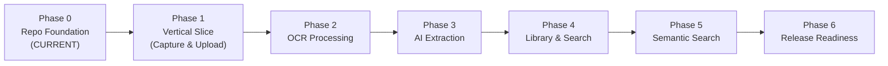

# Rewind Implementation Roadmap

> Status: Master plan for Rewind implementation.
> All phases beyond Phase 0 are **PLANNED**. Do not claim features as implemented unless verified in code.

---

## Overview

---

## Phases

### Phase 0: Repository Foundation
- **Status:** **IN PROGRESS (Finishing)**
- **Scope:**
  - Monorepo structure with `apps/mobile` and `apps/backend`
  - Root agent instruction set (`AGENTS.md`, `CLAUDE.md`, `README.md`)
  - Complete architecture, product, and API contract specifications
  - Mobile Expo + React Native + TypeScript skeleton with home screen
  - Backend Spring Boot 3.x + Java 21 + Gradle skeleton with health endpoint
  - CI workflows for GitHub Actions
  - ADR and task templates

### Phase 1: First Vertical Slice
- **Status:** **PLANNED**
- **Prerequisites:** Phase 0 complete
- **Scope:**
  - Mobile: Camera capture and gallery image picker (`expo-image-picker`)
  - Mobile: Image preview screen
  - Backend: Media upload REST endpoint (`POST /api/v1/media`)
  - Storage: Supabase Storage integration with private bucket
  - Database: `media` table migration with Flyway
  - Backend: Ownership validation and media metadata persistence
  - Mobile: Display uploaded image confirmation

### Phase 2: OCR Integration
- **Status:** **PLANNED**
- **Prerequisites:** Phase 1 complete
- **Scope:**
  - Mobile: On-device OCR integration (Google ML Kit Text Recognition)
  - Mobile: Send OCR text payload alongside media upload
  - Backend: `ocr_results` entity and migration
  - Backend: Storage and retrieval of raw text and bounding boxes
  - Mobile: Display extracted raw text in image detail view

### Phase 3: AI Structured Extraction
- **Status:** **PLANNED**
- **Prerequisites:** Phase 2 complete
- **Scope:**
  - Backend: Vision provider adapter (`GroqVisionService`)
  - Backend: Async processing job pipeline (`processing_jobs`)
  - Backend: JSON schema validation and normalization for extracted data
  - Backend: Evidence linkage connecting structured fields back to OCR text/image
  - Mobile: Processing status polling / display
  - Mobile: Review and edit UI for AI-extracted structured fields

### Phase 4: Library and Keyword Search
- **Status:** **PLANNED**
- **Prerequisites:** Phase 3 complete
- **Scope:**
  - Mobile: Grid and list views for media memory cards
  - Backend: Pagination and sorting for `/api/v1/media`
  - Backend & Mobile: Basic tagging and category assignment
  - Backend: Full-text search on OCR text and extraction fields via PostgreSQL
  - Mobile: Search bar with instant keyword filtering
  - Mobile & Backend: Soft/hard delete with cascading cleanup

### Phase 5: Semantic Search
- **Status:** **PLANNED**
- **Prerequisites:** Phase 4 complete
- **Scope:**
  - Backend: Jina Embeddings API integration
  - Database: `pgvector` extension setup and vector column indexing
  - Backend: Embed normalized text during post-processing
  - Backend: Vector similarity search endpoint (`/api/v1/search?type=semantic`)
  - Mobile: Semantic search results interface with source attribution

### Phase 6: Release Readiness
- **Status:** **PLANNED**
- **Prerequisites:** Phase 4/5 complete
- **Scope:**
  - Security audit and privacy compliance review
  - Account and data deletion workflows
  - Android App Bundle (AAB) build configuration
  - Google Play Store asset preparation and privacy declaration
  - Performance profiling and crash reporting setup
